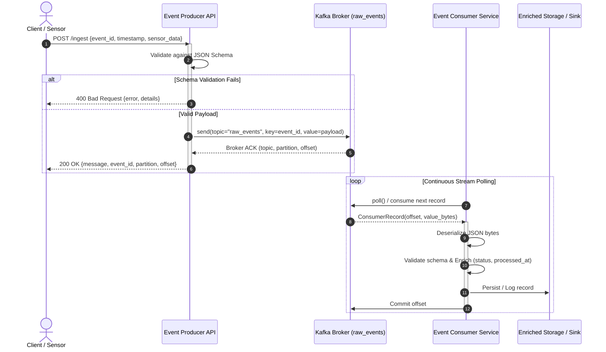

# Real-Time Event Ingestion Pipeline with Apache Kafka & Docker Compose

[](https://www.python.org/)
[](https://kafka.apache.org/)
[](https://docs.docker.com/compose/)
[](https://docs.pytest.org/)
[](LICENSE)

A production-grade, distributed event ingestion and stream processing pipeline built using **Python**, **Apache Kafka**, **Zookeeper**, and **Docker Compose**. 

The system implements a decoupled, event-driven architecture featuring:
1. An HTTP-based **Event Producer Service** that ingests telemetry payloads, enforces strict JSON Schema contracts, and synchronously delivers messages to an Apache Kafka topic.
2. An **Event Consumer Service** running as an independent daemon that subscribes to the message broker, deserializes byte streams, re-validates incoming data integrity, performs business enrichment, logs processing results, and manages Kafka consumer group offsets with graceful teardown semantics.

---

## Architecture Overview

```
                                  +-------------------------------------------------+
                                  |                 DOCKER NETWORK                  |
                                  |                                                 |
[ HTTP Client / IoT Gateway ]     |   +------------------+                          |
             |                    |   |    Zookeeper     |                          |
    POST /ingest (JSON)           |   |   (Port: 2181)   |                          |
             v                    |   +--------+---------+                          |
+--------------------------+      |            | (Cluster Coord)                    |
|      event_producer      |      |            v                                    |
|   - Flask REST API       | ---> |   +------------------+                          |
|   - JSON Schema Validate |      |   |   Apache Kafka   |                          |
|   - Kafka Message Publish|      |   |   (Topic:        |                          |
+--------------------------+      |   |    raw_events)   |                          |
             |                    |   +--------+---------+                          |
        HTTP 200/400/500          |            |                                    |
                                  |            | Stream Subscription                |
                                  |            v                                    |
                                  |   +------------------+      +---------------+   |
                                  |   |  event_consumer  | ---> | Persistence   |   |
                                  |   |  - Deserializer  |      | / Sink Log    |   |
                                  |   |  - Re-Validation |      | (Docker Vol)  |   |
                                  |   |  - Enrichment    |      +---------------+   |
                                  |   |  - Offset Commit |                          |
                                  |   +------------------+                          |
                                  +-------------------------------------------------+
```

### Mermaid Sequence & Data Flow



---

## Directory Structure

```
realtime_events/
├── .env.example             # Documented environment variable template
├── .env                     # Default environment configuration
├── .gitignore               # Git version-control exclusions
├── docker-compose.yml       # Multi-container orchestration (Kafka, Zookeeper, Apps)
├── pytest.ini               # Pytest suite configuration & warning filters
├── requirements.txt         # Consolidated Python dependencies for local testing
├── README.md                # Comprehensive project documentation
├── PROJECT_REPORT.md        # Academic and technical engineering project report
├── producer/
│   ├── Dockerfile           # Lightweight Python 3.11 container for Producer
│   ├── requirements.txt     # Producer dependencies (Flask, kafka-python, jsonschema)
│   ├── __init__.py          # Python package initializer
│   ├── app.py               # REST API endpoints, healthchecks, signal hooks
│   ├── config.py            # Environment configuration parser
│   ├── kafka_producer.py    # Resilient Kafka Producer with retries and health tracking
│   └── schemas.py           # JSON Schema definition and payload validator
├── consumer/
│   ├── Dockerfile           # Lightweight Python 3.11 container for Consumer
│   ├── requirements.txt     # Consumer dependencies (kafka-python, jsonschema)
│   ├── __init__.py          # Python package initializer
│   ├── app.py               # Consumer polling loop, deserializer, shutdown hooks
│   ├── config.py            # Environment configuration parser
│   ├── processor.py         # Business transformation, enrichment, and sink writer
│   └── schemas.py           # Consumer-side data contract validation
├── tests/
│   ├── __init__.py          # Test suite package initializer
│   ├── conftest.py          # Pytest shared fixtures, mocks, and test client
│   ├── test_producer.py     # Unit tests for schema validation, routes, error handling
│   ├── test_consumer.py     # Unit tests for deserializer, processor, sink, and loop
│   └── test_integration.py  # End-to-end integration pipeline tests
└── scripts/
    ├── sample_events.json   # Curated test payloads (valid, edge cases, invalid)
    ├── send_events.py       # CLI tool for streaming or testing event ingestion
    └── verify_pipeline.py   # Automated cluster verification sanity script
```

---

## Data Contract & Event Schema

All events exchanged across the pipeline adhere strictly to the following specification:

```json
{
  "$schema": "https://json-schema.org/draft/2020-12/schema",
  "title": "SensorEvent",
  "type": "object",
  "properties": {
    "event_id": {
      "type": "string",
      "minLength": 1,
      "description": "Unique identifier for the telemetry event"
    },
    "timestamp": {
      "type": "string",
      "format": "date-time",
      "description": "ISO 8601 UTC timestamp string"
    },
    "sensor_data": {
      "type": "number",
      "description": "Numeric sensor measurement value"
    }
  },
  "required": ["event_id", "timestamp", "sensor_data"],
  "additionalProperties": false
}
```

### Producer Ingestion Response (HTTP 200 OK)
```json
{
  "event_id": "sensor-alpha-901",
  "message": "Event ingested successfully",
  "offset": 14,
  "partition": 0,
  "topic": "raw_events"
}
```

### Consumer Enriched Output Format
```json
{
  "event_id": "sensor-alpha-901",
  "timestamp": "2026-10-13T10:30:00Z",
  "sensor_data": 42.15,
  "processed_at": "2026-10-13T10:30:00.312543+00:00",
  "status": "SUCCESS"
}
```

---

## Quickstart & Setup Guide

### Prerequisites
* [Docker Desktop](https://www.docker.com/products/docker-desktop/) (v20.10+ recommended)
* [Docker Compose](https://docs.docker.com/compose/) (v2.0+)
* Optional for local host testing: Python 3.11+ and `pip`

### Step 1: Clone the Repository & Configure Environment
```bash
git clone https://github.com/Adarsh12325/realtime_events.git
cd realtime_events

# Copy the example environment file if .env is missing
cp .env.example .env
```

### Step 2: Launch the Pipeline with Docker Compose
Run the following single command from the `realtime_events/` root:

```bash
docker-compose up -d --build
```

Docker Compose will build the custom Producer and Consumer images, pull the official Confluent Kafka and Zookeeper images, configure the private bridge network, and start all services in dependency order:

1. **Zookeeper** initializes and passes healthchecks on port `2181`.
2. **Kafka** connects to Zookeeper, initializes listeners on ports `9092` and `29092`, and reports healthy.
3. **Event Producer** starts on `http://localhost:5000` with active Kafka brokers.
4. **Event Consumer** joins the consumer group `event_processing_group` and starts listening on topic `raw_events`.

### Step 3: Verify Container Health
Check the container status:
```bash
docker-compose ps
```

All 4 services should report `Up` or `Up (healthy)`.

---

## API Usage & Endpoints

### 1. Service Health Check
```bash
curl -X GET http://localhost:5000/health
```
**Response (200 OK):**
```json
{
  "broker_url": "kafka:9092",
  "kafka_connected": true,
  "service": "event_producer",
  "status": "healthy",
  "target_topic": "raw_events"
}
```

### 2. Retrieve Canonical Event Schema
```bash
curl -X GET http://localhost:5000/schema
```

### 3. Ingest a Valid Event
```bash
curl -X POST http://localhost:5000/ingest \
  -H "Content-Type: application/json" \
  -d '{
    "event_id": "temp-sensor-001",
    "timestamp": "2026-10-13T12:00:00Z",
    "sensor_data": 23.45
  }'
```
**Response (200 OK):**
```json
{
  "event_id": "temp-sensor-001",
  "message": "Event ingested successfully",
  "offset": 0,
  "partition": 0,
  "topic": "raw_events"
}
```

### 4. Ingest an Invalid Event (Missing Required Field)
```bash
curl -X POST http://localhost:5000/ingest \
  -H "Content-Type: application/json" \
  -d '{
    "event_id": "temp-sensor-002",
    "timestamp": "2026-10-13T12:00:00Z"
  }'
```
**Response (400 Bad Request):**
```json
{
  "details": "Validation error at 'root': 'sensor_data' is a required property",
  "error": "Invalid event schema"
}
```

### 5. Ingest an Invalid Event (Wrong Data Type)
```bash
curl -X POST http://localhost:5000/ingest \
  -H "Content-Type: application/json" \
  -d '{
    "event_id": "temp-sensor-003",
    "timestamp": "2026-10-13T12:00:00Z",
    "sensor_data": "HIGH_TEMPERATURE_ALARM"
  }'
```
**Response (400 Bad Request):**
```json
{
  "details": "Validation error at 'sensor_data': 'HIGH_TEMPERATURE_ALARM' is not of type 'number'",
  "error": "Invalid event schema"
}
```

### 6. Non-JSON Request Handling
```bash
curl -X POST http://localhost:5000/ingest \
  -H "Content-Type: text/plain" \
  -d 'Non-JSON text'
```
**Response (400 Bad Request):**
```json
{
  "error": "Request must be JSON"
}
```

---

## Observing Consumer Processing & Logs

Follow the real-time event processing logs in the consumer container:

```bash
docker-compose logs -f event_consumer
```

Expected log output:
```log
2026-10-13 12:00:01,123 [INFO] [event_consumer.app]: Consumer active and listening for events on topic 'raw_events'...
2026-10-13 12:00:05,456 [INFO] [event_consumer.app]: Received message from topic=raw_events, partition=0, offset=0
2026-10-13 12:00:05,457 [INFO] [event_consumer.processor]: Successfully processed event_id='temp-sensor-001' (sensor_data=23.45)
```

To view the persisted output log sink stored inside the Docker volume:
```bash
docker-compose exec event_consumer cat /app/data/processed_events.log
```

---

## Automated Ingestion Testing Scripts

A set of automated CLI utilities is provided under `scripts/`:

### Run Predefined Test Suite (Valid + Negative Cases)
```bash
python scripts/send_events.py --mode samples
```
This tool reads `scripts/sample_events.json`, issues calls against `http://localhost:5000/ingest`, and validates that each payload receives its expected HTTP response (200 vs 400).

### Stream Simulated Real-Time Telemetry
```bash
python scripts/send_events.py --mode stream --count 20 --delay 0.5
```
Simulates 20 live sensor telemetry readings emitted at 500ms intervals.

### End-to-End Sanity Verification Script
```bash
python scripts/verify_pipeline.py
```
Probes health endpoints, submits a distinct verification payload, queries consumer container logs, and verifies end-to-end receipt automatically.

---

## Running the Automated Test Suite

### Method A: Local Host Execution (Fastest)
Install dependencies and run pytest from the project root:

```bash
pip install -r requirements.txt
pytest -v
```

**Results:**
```
tests/test_consumer.py::TestConsumerProcessor::test_process_valid_event_success PASSED
tests/test_consumer.py::TestConsumerProcessor::test_process_invalid_event_validation_failed PASSED
tests/test_consumer.py::TestConsumerProcessor::test_process_non_dict_event_failed PASSED
tests/test_consumer.py::TestConsumerDeserializer::test_deserialize_valid_json_bytes PASSED
tests/test_consumer.py::TestConsumerDeserializer::test_deserialize_corrupted_bytes_returns_none PASSED
tests/test_consumer.py::TestConsumerDeserializer::test_deserialize_none_returns_none PASSED
tests/test_consumer.py::TestConsumerSinkWriter::test_write_to_sink_file PASSED
tests/test_consumer.py::TestConsumerServiceLoop::test_consumer_processes_stream_and_stops PASSED
tests/test_consumer.py::TestConsumerServiceLoop::test_stop_signal_breaks_loop PASSED
tests/test_integration.py::TestEndToEndPipelineIntegration::test_end_to_end_pipeline_flow PASSED
tests/test_integration.py::test_live_docker_pipeline_if_available SKIPPED
tests/test_producer.py::TestProducerSchemaValidation::test_valid_payload_passes_validation PASSED
tests/test_producer.py::TestProducerSchemaValidation::test_missing_required_property_fails PASSED
tests/test_producer.py::TestProducerSchemaValidation::test_invalid_data_types_fail PASSED
tests/test_producer.py::TestProducerSchemaValidation::test_disallowed_additional_properties_fail PASSED
tests/test_producer.py::TestProducerSchemaValidation::test_non_dict_payload_fails PASSED
tests/test_producer.py::TestProducerEndpoints::test_root_endpoint PASSED
tests/test_producer.py::TestProducerEndpoints::test_health_endpoint_healthy PASSED
tests/test_producer.py::TestProducerEndpoints::test_health_endpoint_degraded PASSED
tests/test_producer.py::TestProducerEndpoints::test_schema_endpoint PASSED
tests/test_producer.py::TestProducerEndpoints::test_ingest_valid_event_success PASSED
tests/test_producer.py::TestProducerEndpoints::test_ingest_non_json_request_rejected PASSED
tests/test_producer.py::TestProducerEndpoints::test_ingest_missing_required_field_rejected PASSED
tests/test_producer.py::TestProducerEndpoints::test_ingest_invalid_types_rejected PASSED
tests/test_producer.py::TestProducerEndpoints::test_ingest_uninitialized_producer_returns_500 PASSED
tests/test_producer.py::TestProducerEndpoints::test_kafka_publish_exception_returns_500 PASSED

======================== 25 passed, 1 skipped in 4.5s ========================
```

### Method B: Inside Docker Container
To test directly inside the containerized environment:
```bash
docker-compose exec event_producer pytest -v /app/tests
```

---

## Environment Variables Configuration

| Variable | Default Value | Description |
|---|---|---|
| `KAFKA_BROKER_URL` | `kafka:9092` | Host and port of the Apache Kafka bootstrap broker. |
| `KAFKA_TOPIC` | `raw_events` | Kafka topic where telemetry events are published and consumed. |
| `CONSUMER_GROUP_ID` | `event_processing_group` | Kafka consumer group name for offset tracking and horizontal scaling. |
| `AUTO_OFFSET_RESET` | `earliest` | Position to resume when no initial offset exists (`earliest` or `latest`). |
| `ENABLE_AUTO_COMMIT` | `true` | Enables automatic periodic offset commits by the Kafka consumer. |
| `PRODUCER_HOST` | `0.0.0.0` | Host interface for the Producer REST API web server. |
| `PRODUCER_PORT` | `5000` | HTTP port exposed by the Producer REST API. |
| `LOG_LEVEL` | `INFO` | Application log verbosity (`DEBUG`, `INFO`, `WARNING`, `ERROR`). |
| `KAFKA_RETRIES` | `10` | Maximum connection retry attempts on startup. |
| `KAFKA_RETRY_BACKOFF_MS` | `2000` | Milliseconds to wait between connection retry attempts. |
| `REQUEST_TIMEOUT_SECONDS` | `10.0` | Maximum timeout when awaiting delivery acknowledgment from Kafka. |
| `OUTPUT_LOG_PATH` | `/app/data/processed_events.log` | File path for persisting transformed consumer records. |

---

## Graceful Teardown & Resource Management

Both services capture OS-level termination signals (`SIGTERM` and `SIGINT`):

* **Event Producer**: When a shutdown signal is intercepted, the service flushes any buffered in-flight messages to Kafka within a 5-second timeout window and closes socket connections cleanly.
* **Event Consumer**: Intercepting a shutdown signal sets `running = False`, allowing the active message processing batch to complete, committing current offsets to Kafka to avoid message reprocessing, and closing consumer coordinator connections.

To stop the Docker Compose cluster cleanly:
```bash
docker-compose down
```

To remove all persistent volumes and cached containers:
```bash
docker-compose down -v
```

---

## Troubleshooting Guide

### 1. `ConnectionRefusedError: [Errno 111] Connection refused`
* **Cause**: The Producer or Consumer container attempted to communicate with Kafka before the broker finished leader election.
* **Resolution**: Both services incorporate built-in connection retry loops with exponential backoff (`KAFKA_RETRIES=10`). In addition, `docker-compose.yml` specifies `depends_on: kafka: condition: service_healthy` to delay service startup until Kafka passes health checks.

### 2. `Invalid event schema` returned on valid-looking timestamp
* **Cause**: ISO 8601 timestamps must adhere to RFC 3339 format (e.g., `2026-10-13T10:30:00Z` or `2026-10-13T10:30:00+00:00`).
* **Resolution**: Ensure timestamps include timezone designators (`Z` or explicit offset `+00:00`).

### 3. Port Conflicts on 5000 or 9092
* **Cause**: Another service (or Docker container) on your host is bound to port `5000` or `9092`.
* **Resolution**: Update the external port mapping in `docker-compose.yml` (e.g. `"5050:5000"`) and update `.env`.

---

## Production Scalability & Future Enhancements

1. **Dead Letter Queue (DLQ)**: In production, messages failing schema validation (`FAILED_VALIDATION`) or processing exceptions should be routed to a dedicated `raw_events_dlq` topic for automated alerting and inspection.
2. **Schema Registry Integration**: Replace static in-code JSON Schemas with the Confluent Schema Registry using Apache Avro or Protobuf for centralized data governance and forward/backward compatibility guarantees.
3. **Horizontal Consumer Scaling**: Increase Kafka topic partitions (e.g., 8 partitions) and scale the consumer service (`docker-compose up --scale event_consumer=4`) to achieve parallel processing across partitions.
4. **Data Sink Integration**: Extend the consumer output sink to write directly into an analytical storage engine such as ClickHouse, DuckDB, PostgreSQL, or an Amazon S3 Parquet data lake.
